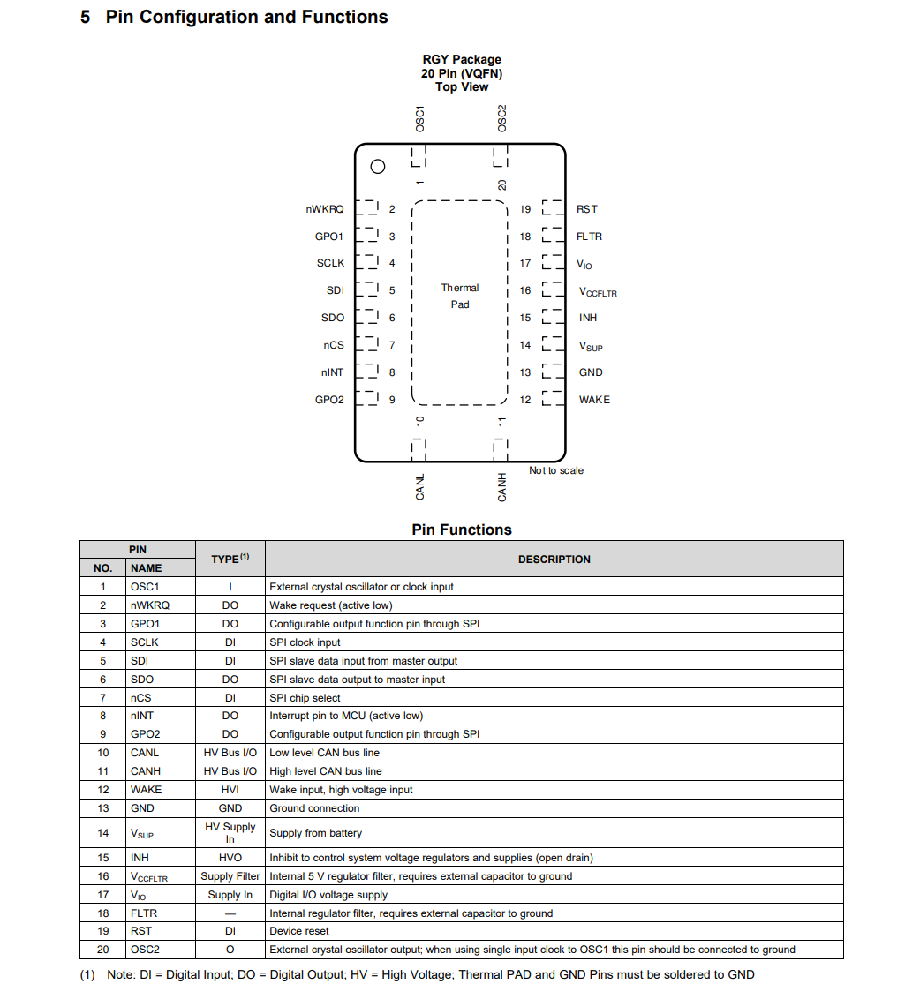
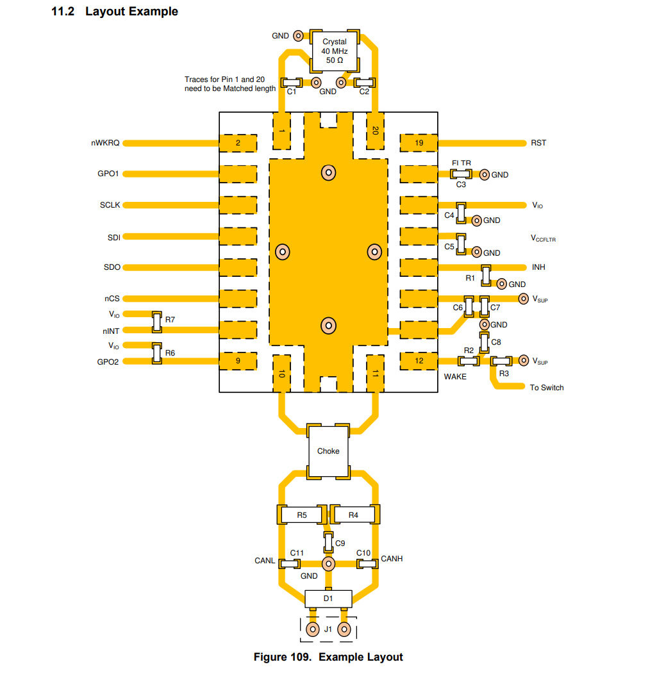

# TCAN4x5x CAN-FD Library for Arduino

A robust, hardware-agnostic C++ library for the Texas Instruments **TCAN4550** and **TCAN4551** CAN-FD controllers. 

This library takes Texas Instruments' low-level ANSI-C driver and wraps it into a modern, flexible Arduino interface. It is built specifically for bare-metal performance, bypassing slow polling loops in favor of true hardware Interrupt Service Routines (ISRs) and advanced internal hardware routing.

> **Supported Architectures & Custom SPI Routing:**  
> Compatible with all standard Arduino architectures (AVR, SAMD, Renesas UNO R4) using default hardware SPI pins, with built-in automatic SPI pin multiplexing (`TCAN4x5x(CS, MISO, MOSI, SCK)`) for **ESP32**, **RP2040 / RP2350**, **STM32**, and **Teensy**.

## Key Features
* **True Hardware ISRs:** Utilizes a direct-return architecture (`TCAN_RX_Packet`) allowing you to write your own non-blocking interrupt routines without rigid static wrappers. Includes a clean `attachInterruptPin()` helper to eliminate Arduino boilerplate.
* **Advanced Hardware Routing:** Natively map High Priority Messages (HPM) to physically trigger independent hardware pins like `GPO1` or `GPO2`.
* **Cross-Platform Custom SPI:** Works out-of-the-box with standard 8-bit AVRs, while automatically handling architecture-specific SPI pin remapping inside `begin()` for modern 32-bit microcontrollers (**ESP32, RP2040, RP2350, STM32, and Teensy**).
* **Payload Struct Packing:** Send and receive complex C++ data structs directly over the CAN-FD data phase.

## Hardware & Wiring

The TCAN4x5x uses a 20-pin VQFN package. The library relies on standard SPI communication alongside dedicated hardware interrupt pins.

### Pin Configuration
Below is the official pinout and description for the TCAN4x5x family:



| TCAN Pin | Name | Description | Arduino Connection |
| :--- | :--- | :--- | :--- |
| **4** | SCLK | SPI Clock Input | Standard SCK |
| **5** | SDI | SPI Data Input | Standard MOSI |
| **6** | SDO | SPI Data Output | Standard MISO |
| **7** | nCS | SPI Chip Select | Any Digital Pin (Passed to constructor) |
| **8** | nINT | Main Interrupt | External Interrupt Pin (e.g., Pin 2) |
| **3** | GPO1 | Configurable Output | Optional: Secondary Interrupt Pin |
| **9** | GPO2 | Configurable Output | Optional: Secondary Interrupt Pin |

### Example Board Layout
For custom PCB designs, ensure traces for the 40 MHz crystal (Pins 1 and 20) are length-matched, and appropriate bypass capacitors are placed near the supply pins.



## Installation

1. Download this repository as a `.zip` file.
2. Open the Arduino IDE.
3. Navigate to **Sketch** -> **Include Library** -> **Add .ZIP Library...**
4. Select the downloaded `.zip` file.

## Quick Start: Basic Receive

This minimal example demonstrates how to initialize the controller and read incoming standard CAN traffic using a hardware interrupt.

```cpp
/*
 * TCAN4x5x Robust Receive Example
 * 
 * Demonstrates safe hardware interrupt handling by keeping the ISR incredibly 
 * short and deferring all Serial printing to the main loop.
 */

#include 
#include 

const uint8_t CS_PIN = 10;
const uint8_t NINT_PIN = 2;

TCAN4x5x myCAN(CS_PIN);

// Volatile variables for safe ISR-to-Loop data transfer
volatile bool packetReady = false;
TCAN_RX_Packet rxPacket; 

// True Hardware Interrupt Service Routine
void canISR() {
    // Extract the bundled data packet directly from the library
    TCAN_RX_Packet tempPacket = myCAN.handleReceiveISR();
    
    if (tempPacket.valid) {
        rxPacket = tempPacket; // Copy to global struct
        packetReady = true;    // Flag the main loop
    }
}

void setup() {
    Serial.begin(115200);
    while (!Serial);

    // Cleanly attach the hardware interrupt via the library helper
    myCAN.attachInterruptPin(NINT_PIN, canISR);

    Serial.println("Starting CAN Controller...");
    myCAN.begin(&SPI);
    
    // Optional: Verify hardware communication
    uint16_t devVersion = myCAN.Device_ReadDeviceVersion();
    Serial.print("Device Version: 0x");
    Serial.println(devVersion, HEX);
}

void loop() {
    if (packetReady) {
        // Clear flag immediately to allow next interrupt
        packetReady = false; 

        Serial.print("Message Received! ID: 0x");
        Serial.print(rxPacket.header.ID, HEX);
        Serial.print(" | DLC Bytes: ");
        Serial.print(rxPacket.length);
        
        Serial.print(" | Data: ");
        for (int i = 0; i < rxPacket.length; i++) {
            Serial.print("0x");
            Serial.print(rxPacket.data[i], HEX);
            Serial.print(" ");
        }
        Serial.println();
    }
}
```

##Advanced Configuration & Hardware Routing
The library pre-loads safe Texas Instruments default settings (500k/2M bit rates, standard filters). Advanced users can override these by calling the configuration setters before begin().

A key feature of this library is the ability to route specific High Priority CAN IDs to separate hardware pins (GPO1 or GPO2). Due to the physical silicon design of the TCAN4x5x family, GPO2 is permanently hardwired to internal MCAN_INT0, and GPIO1 is permanently hardwired to internal MCAN_INT1:

GPIO1 Multiplexer Limits:


GPO2 Multiplexer Limits:


Because of this physical hardware limitation, the library uses a software toggle (INT_0 or INT_1) inside setPriorityCANIDList() to digitally steer your priority messages down the correct internal pipe to match the physical pin you chose.

```cpp
void priorityISR() {
    TCAN_RX_Packet tempPacket = myCAN.handleGPOISR();
    if (tempPacket.valid) {
        // Process urgent packet...
    }
}

void setup() {
    // 1. Set custom bit rates (e.g., 1 Mbps Arbitration)
    myCAN.setNominalBitRate(1, 32, 8); 
    
    // 2. Configure physical pin (e.g., Route interrupts to GPO1)
    myCAN.setGPIO1Interrupt();
    myCAN.attachInterruptPin(3, priorityISR);

    // 3. Boot the chip to commit settings to hardware
    myCAN.begin(&SPI);
    
    // 4. Steer dynamic filters down the INT_1 pipe to trigger GPO1
    uint16_t priorityIDs[] = {0x055, 0x123};
    myCAN.setPriorityCANIDList(priorityIDs, 2, INT_1);
}
```
Check out the examples folder for more advanced usage, including packing C++ structs and configuring custom SPI pins for ESP32/RP2040.

##License
This library is released under the BSD 3-Clause License. It is built upon the foundational register maps and ANSI-C hardware abstraction layer originally developed and copyrighted by Texas Instruments Incorporated.
